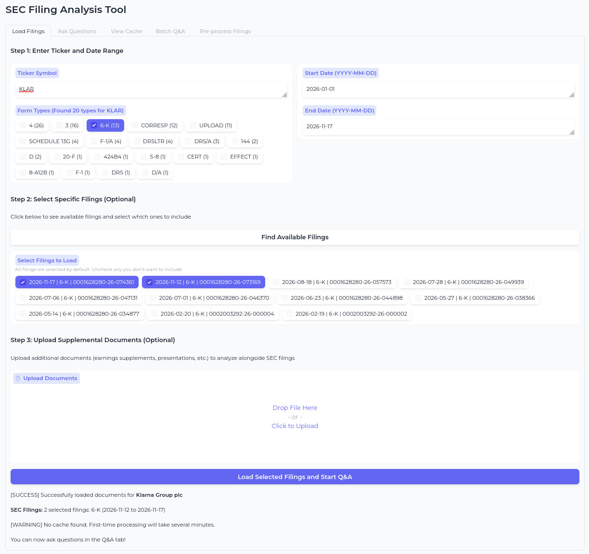
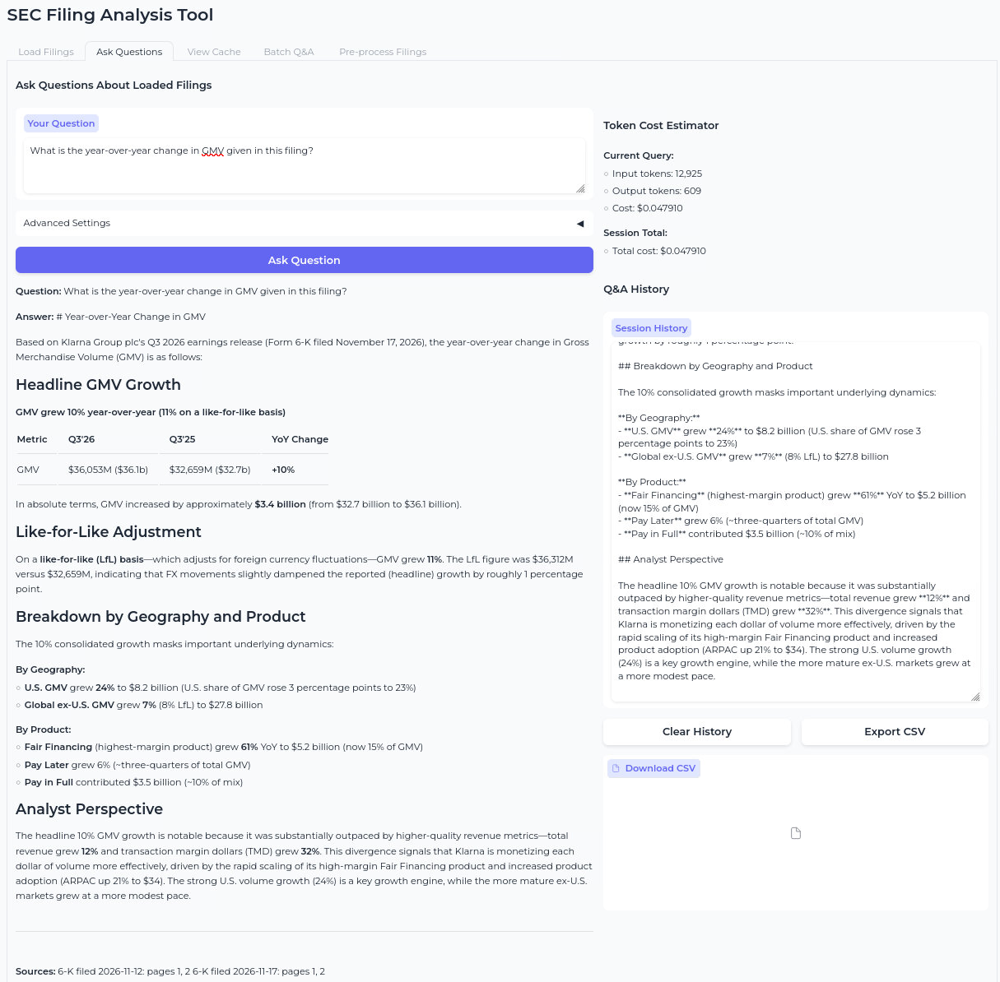

# SEC-RAG

Ask questions about SEC filings and get answers grounded in the filing text. SEC-RAG pulls filings straight from SEC EDGAR, extracts text, tables and financial data, indexes them in a local vector store, and answers questions with an LLM using retrieved passages as context. It ships with a Gradio web app.

## Screenshots

**Load filings:** pick a ticker, form types and date range, then choose specific filings (here, Klarna 6-Ks), or upload your own documents.



**Ask questions:** answers cite the filing, with a per-query token cost estimate and a running session history that can be exported to CSV.



Both screenshots use public SEC filings (Klarna Group plc, Form 6-K).

## Features

- **EDGAR download by ticker, form type and date range**: 10-K, 10-Q, 8-K, 6-K, F-1 and others. Lists the filings available for a company and lets you pick specific ones.
- **Beyond plain text extraction**
  - Inline XBRL facts (assets, revenue, net income, EPS) and filing metadata
  - Balance sheet, income statement and cash flow detection
  - Tables preserved as markdown using pandas
  - Automatic detection of exhibits (e.g. Exhibit 99.1) behind 6-K / 8-K cover pages
  - Optional PDF exhibit text extraction and OCR for images
- **Persistent embedding cache**: embeddings are computed once per ticker / form types / date range and stored in a local FAISS index, so repeat queries load instantly.
- **Hybrid retrieval**: semantic similarity search combined with keyword matching, with the option to show the retrieved source chunks.
- **Web app tabs**: Load Filings, Ask Questions, View Cache, Batch Q&A (many tickers x many questions, with a generated summary report), and Pre-process Filings.
- **Extras**: upload your own PDF / DOCX documents, per-query token and cost estimates, CSV export of Q&A sessions.
- **Provider-agnostic**: works with any OpenAI-compatible chat and embeddings API.

## How it works

```
EDGAR API -> extract (text, XBRL, tables, exhibits, OCR) -> chunk (8000 chars, 400 overlap)
          -> embed -> FAISS index (cached in index/) -> retrieve top-k -> LLM -> answer
```

## Setup

```bash
python -m venv .venv && source .venv/bin/activate
pip install -r requirements.txt
cp .env.example .env     # then edit: add LLM_API_KEY and SEC_USER_AGENT
./run.sh                 # or: python app.py
```

OCR is optional and needs the `tesseract-ocr` system package. The PDF summary for Batch Q&A is optional and needs `pandoc` with XeLaTeX.

## Configuration

All settings are environment variables, which can live in `.env` (see `.env.example`).

| Variable | Purpose | Default |
|---|---|---|
| `LLM_API_KEY` | API key (`OPENAI_API_KEY` also accepted) | required |
| `LLM_BASE_URL` | OpenAI-compatible endpoint for chat and embeddings | `https://api.openai.com/v1` |
| `LLM_MODEL` | Chat model | `gpt-4o` |
| `EMBEDDING_MODEL` | Embedding model | `text-embedding-3-small` |
| `SEC_USER_AGENT` | Contact string SEC EDGAR requires, e.g. `Jane Doe jane@example.com` | placeholder |
| `LLM_INPUT_COST_PER_M` / `LLM_OUTPUT_COST_PER_M` | USD per million tokens, used for the cost display | 2.50 / 10.00 |
| `HTTPS_PROXY` / `HTTP_PROXY` | Optional outbound proxy for EDGAR requests | none |
| `SEC_RAG_PORT` | Local port | `7860` |
| `SEC_RAG_SHARE` | `1` creates a temporary public gradio.live link | `0` |

## Notes

- Changing the embedding model or chunk size invalidates cached embeddings; delete `index/` to rebuild.
- Cost figures are estimates based on tiktoken counts, not provider billing.
- Not financial advice; always check answers against the source filing.
